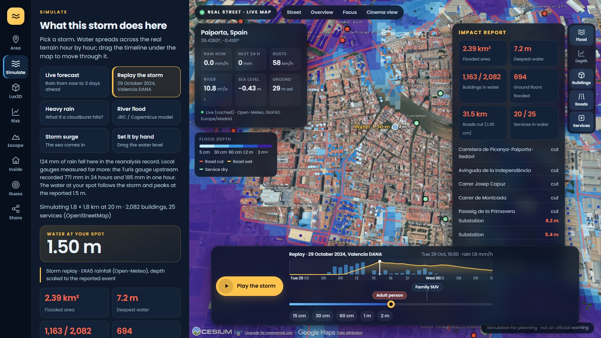
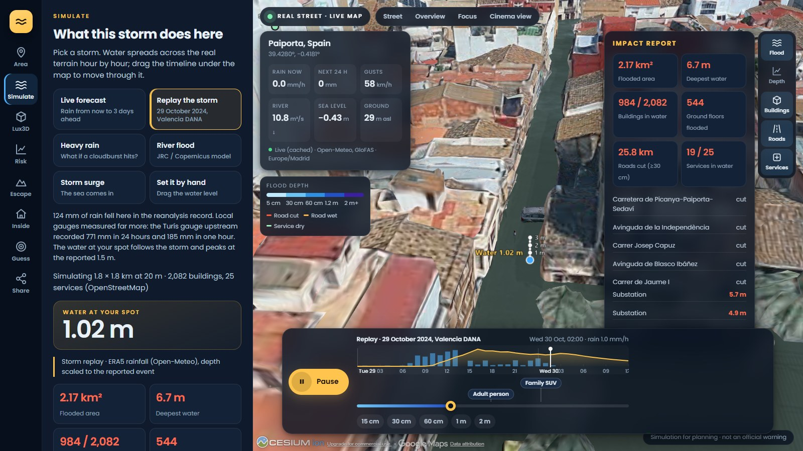
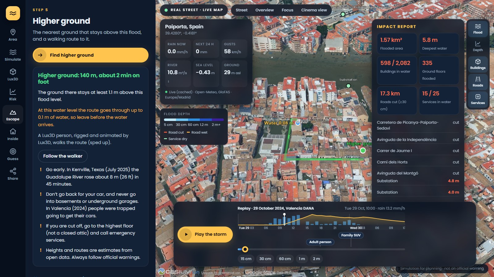
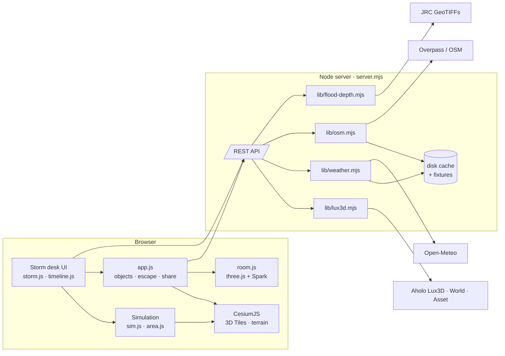

# Waterline

**See what a storm does to your street — before it comes.**

Waterline is a flood-impact simulator in a photorealistic 3D city. Pick a place and a storm (today's
forecast, a replay of a real flood with its recorded rainfall, a river flood from the JRC model, or
your own "what if"), and the water spreads across real terrain hour by hour. Buildings, roads,
schools and clinics from OpenStreetMap light up as it reaches them, and **Aholo Lux3D** puts the
things you own — your car, your front door, a person your height — into the water at true scale.
Then it shows the way to higher ground.

Built for the **Manycore Aholo Global 3D AI Hackathon 2026**.



> Flood maps show risk as a blue patch, and people underestimate it. Waterline shows the water at
> *your* car's windows, on *your* street, and counts what else goes under with it.

---

## Contents

- [What it does](#what-it-does)
- [How Aholo is used](#how-aholo-is-used)
- [How the simulation works](#how-the-simulation-works)
- [Data sources](#data-sources)
- [Quick start](#quick-start)
- [Architecture](#architecture)
- [Server API](#server-api)
- [Project layout](#project-layout)
- [Testing and verification](#testing-and-verification)
- [Hackathon submission package](#hackathon-submission-package)
- [Limits](#limits)
- [Credits](#credits)

## What it does

| | |
|---|---|
| **Storm desk** | A map-first, weather-style interface: location card with live rain, gusts, river discharge and sea level; a layer rail (flood, depth colours, buildings, roads, services); a depth legend; and a timeline under the map with hourly rain bars and the water depth at your spot. |
| **Five storm scenarios** | **Live forecast** (Open-Meteo hourly rain, yesterday to 3 days ahead) · **Replay the storm** (the recorded ERA5 rainfall of a real flood) · **Heavy rain** what-if (50–400 mm over 3–24 h) · **River flood** (JRC / Copernicus return periods at your spot) · **Storm surge** what-if. Or set the water by hand. |
| **Area simulation** | 1.8 × 1.8 km of bare-earth terrain at 20 m resolution, flooded hour by hour. Realistic water at street level, depth colours from above. |
| **Impact report** | Flooded area, deepest water, buildings in water and ground floors flooded, kilometres of road cut (≥ 30 cm, where cars float), and named schools, clinics, pharmacies, fire stations and substations with their depth. |
| **Your things, true scale** | Snap a photo or type a description: **Lux3D** builds a 3D model in about two minutes, sized to its real height and placed on the street. The impact report tracks it: *wheels in water → up to the windows → completely under*. |
| **After the flood** | When the water drops, the SUV swaps to a mud-stained version made with **Lux3D material transfer**. |
| **A way out** | Searches the terrain for the nearest ground 1 m above the flood, gets a walking route (OSRM on OpenStreetMap), reports how deep the water on the way would be, and a **Lux3D-rigged person** walks the route. |
| **Inside your home** | **Aholo World** turns one photo of a room into a 3D Gaussian-splat room, and the same flood comes in through the door. |
| **Take it with you** | Export any object as **USDZ** for AR on a phone or **STL** for 3D printing (**Lux3D multi-format export**). |
| **Real floods** | Kerrville, Texas (4 July 2025) and Paiporta, Spain (29 October 2024), with their recorded rainfall, ship as one-click replays. |

<p>
  
  
</p>

## How Aholo is used

Every object in the water is made by Aholo, and Lux3D runs **live inside the app** (the server keeps
the API key private, with per-visitor and daily limits). Nine Lux3D endpoints are used, plus Aholo
World and the Asset service:

| Aholo service | Endpoint | Where it shows up in Waterline |
|---|---|---|
| Lux3D | `generate/img-to-3d` | Photo of your car, scooter or door → true-scale 3D model (live) |
| Lux3D | `generate/text-to-3d` | "a red pickup truck" → 3D model (live); most of the Library |
| Lux3D | `generate/multimodal-to-image` | Mud-stained reference image; A-pose reference for rigging |
| Lux3D | `generate/material-transfer` | "After the flood" SUV, swapped in as the water drops |
| Lux3D | `animations/rig` + `animations/retarget` | The person who walks the escape route (walk cycle) |
| Lux3D | `part-split` | SUV split into body and four wheels |
| Lux3D | `articulation-animation` | Front door found its hinge and opens |
| Lux3D | `multi-format-export` | USDZ (AR) and STL (3D print) — live via `POST /api/export` |
| Aholo World | `world/v1/generations` | A 3D room from one photo, flooded with the street's water |
| Asset | `asset/v1/token` + upload | Photos and models sent to the services above |

Provenance — task ids, prompts or source photos, timings, sizes and SHA-256 hashes — is recorded in
[`public/models/library.json`](public/models/library.json) and
[`public/models/extras/extras.json`](public/models/extras/extras.json).
`npm run generate` adds Library models; `node scripts/lux3d-extras.mjs` regenerates the extras.

Aholo does not offer a flood-simulation API, so the hydrology is Waterline's own (below), driven by
public terrain, weather and map data. Aholo's role is the 3D content that makes the result personal.

## How the simulation works

1. **Terrain grid.** 90 × 90 samples of Cesium World Terrain around your spot (1.8 km square, 20 m
   cells), with gaps patched and a 3 × 3 median filter that removes building bumps the terrain model
   carries in dense towns.
2. **Sloping valleys.** A plane is fitted to the valley floor (iteratively, to the cells at or below
   it, capped at 2 %) and removed, so one water level stands for a surface that slopes with the
   valley — a *relative elevation model* — instead of a flat lake drowning everything downhill.
3. **Connected flooding.** Water enters at the lowest ground (the river channel or shore) and at your
   spot, and spreads to every cell it can reach without climbing above the water level. A
   priority-flood pass computes, once, the level at which each cell joins the flood, so any level
   renders instantly.
4. **Scenarios set the level over time.**
   - *Rain* (forecast, what-if): hourly rain × 0.7 runoff, minus 10 mm/h the drains carry, stored in
     a leaky reservoir over the square; the volume is converted to a water level by binary search.
   - *Replay*: the recorded rainfall drives a lagged rise-and-fall response, scaled to the depth
     reported at the street in the real event.
   - *River*: a 48-hour hydrograph peaking at the JRC modelled depth for the chosen return period.
   - *Surge*: tide plus a surge bulge peaking at the chosen height.
5. **Impacts.** Each OpenStreetMap building, road sample and service is matched to a grid cell; its
   depth is read at the lowest ground beside it.

Street level comes from the 3D city itself (both models use the WGS84 ellipsoid), with a sanity check
against the terrain. The maths is in [`public/sim.js`](public/sim.js) and covered by unit tests.

## Data sources

| Data | Source | Notes |
|---|---|---|
| 3D city, terrain, place search | Google Photorealistic 3D Tiles, Cesium World Terrain, Google geocoder via Cesium ion | Needs a Cesium ion token |
| Rain, wind (forecast) | Open-Meteo Forecast API | Cached 30 min |
| Recorded storms | Open-Meteo Historical Weather API (ERA5 reanalysis) | Cached permanently |
| River discharge | Open-Meteo Flood API (GloFAS) | Shown on the location card |
| Sea level | Open-Meteo Marine API | Used to check whether a surge is plausible |
| River flood depths | JRC / Copernicus *Global river flood hazard maps* v2.1 | Read from cloud GeoTIFFs with HTTP range requests |
| Buildings, roads, services | OpenStreetMap via Overpass (three mirrors) | Cached 14 days |
| Walking routes | FOSSGIS OSRM on OpenStreetMap | |

Every live source is optional. The server caches responses on disk, fails over between Overpass
mirrors, serves stale data when a service is down, and falls back to fixtures in
[`data/fixtures/`](data/fixtures) for the demo places, so the replays work even offline.
`npm run prewarm` refreshes the fixtures.

## Quick start

Requirements: **Node.js 22.9+**. Microsoft Edge is used by the browser checks and capture scripts.

```bash
npm ci
cp .env.example .env      # add LUX3D_API_KEY and CESIUM_ION_TOKEN
npm start                 # http://localhost:3000
```

| Key | Where | Needed for |
|---|---|---|
| `LUX3D_API_KEY` | https://labs.aholo.ai/api-keys | Making models, rooms and exports in the app |
| `CESIUM_ION_TOKEN` | https://ion.cesium.com/tokens (add *Google Photorealistic 3D Tiles* in the Asset Depot) | The real 3D city and terrain |

- **No keys?** `http://localhost:3000/?mode=studio` opens the offline Studio: an original illustrative
  street with the Lux3D SUV and a rising water plane (no area simulation, no live data).
- **With keys:** the homepage offers *Replay a real flood*, *Simulate my area* (search or use your
  location) and the Studio. `?app&nodemo` skips the homepage; `?debug` exposes `window.waterline`.

Optional settings in `.env`: `PORT`, `MAX_GENERATIONS_PER_DAY` (default 40),
`MAX_GENERATIONS_PER_IP_PER_HOUR` (6), `TRUST_PROXY=1` behind a trusted proxy, `LUX3D_BASE_URL`.

### Docker

```bash
docker build -t waterline .
docker run -p 3000:3000 --env-file .env waterline
```

Persist `.waterline/` and `public/models/generated/` to keep tasks, caches and new models across
redeploys. Generation quotas are per process.

## Architecture



Plain JavaScript modules, no build step and no framework. CesiumJS and three.js/Spark are served
locally. The server is a single `node:http` app with injectable dependencies for testing.

## Server API

| Method | Path | Purpose |
|---|---|---|
| GET | `/api/health` | Readiness |
| GET | `/api/config` | Cesium token and whether generation is enabled |
| POST | `/api/generate` | Lux3D image- or text-to-3D (`{image}` data URL or `{prompt}`) → `{taskId}` |
| GET | `/api/task?id=` | Poll a Lux3D task; the GLB is saved under `public/models/generated/` |
| POST / GET | `/api/world` | Aholo World room from a photo and/or description; poll with `?id=` |
| POST / GET | `/api/export` | Lux3D multi-format export of a served model (`usdz`, `stl`, `3mf`); poll with `?id=` |
| GET | `/api/weather?lat=&lon=` | Forecast rain and wind, river discharge, sea level |
| GET | `/api/weather/event?lat=&lon=&start=&end=` | Recorded hourly rain and discharge (≤ 10 days) |
| GET | `/api/osm?lat=&lon=&radius=` | Buildings, roads and services (200–1500 m) |
| GET | `/api/flood-depth?lat=&lon=` | JRC modelled river-flood depths by return period |
| GET | `/api/route?from=lon,lat&to=lon,lat` | Walking route (≤ 15 km) |

Responses from the data routes carry a `status`: `live`, `cached`, `stale` or `fixture`.

## Project layout

```
server.mjs                 web server, API routes, private Lux3D proxy
lib/lux3d.mjs              Aholo client: upload, Lux3D tasks (3D, image, material, rig, parts, export…), World
lib/lux3d-extras-routes.mjs  /api/export handlers (multi-format export)
lib/weather.mjs            Open-Meteo forecast, archive, flood and marine
lib/osm.mjs                Overpass query with mirror failover
lib/disk-cache.mjs         TTL disk cache, stale fallback, fixtures
lib/flood-depth.mjs        JRC flood-depth GeoTIFFs over HTTP range requests
public/index.html          homepage and storm-desk shell
public/theme.css           storm-desk theme (on top of style.css)
public/app.js              map, objects, escape route, Lux3D extras, sharing, place search
public/sim.js              flood simulation (pure functions, unit-tested)
public/area.js             terrain sampling, area water and impact layers in Cesium
public/storm.js            weather card, scenarios, timeline playback, impact report
public/scenarios.js        scenario time series
public/timeline.js         the timeline canvas
public/room.js             Aholo World room viewer (three.js + Spark)
public/models/             Lux3D Library, extras and Aholo World example room
data/fixtures/             offline weather, storm and OSM data for the demo places
scripts/                   generation, capture, verification and submission tools
test/                      node --test suites
```

## Testing and verification

```bash
npm test                  # unit and server tests, fully offline
npm run verify:demo       # real Cesium in Edge, Studio flow, all external requests blocked
node scripts/snap.mjs     # screenshots of a live replay (server must be running)
```

`npm test` covers the simulation maths, the weather/OSM data layer (failover, cache, fixtures,
validation), the Lux3D client and export routes, and the server. `verify:demo` drives the real 3D
engine offline: placement, undo, depth challenge, share links, scene files, PNG export and the mobile
layout.

## Hackathon submission package

| Script | Output |
|---|---|
| `node --env-file-if-exists=.env scripts/capture-sim.mjs` | Simulator screenshots and Lux3D renders in `submission/report/` |
| `npm run submission` | `submission/Waterline-project-report.pdf`, Lux3D evidence, checklist, X post draft, source archive |
| `node --env-file-if-exists=.env scripts/record-demo.mjs` | The captioned demo video `submission/waterline-demo.webm` (one live Lux3D generation) |
| `node scripts/webm-to-mp4.mjs submission/waterline-demo.webm submission/waterline-demo.mp4` | MP4 copy for upload forms |

None of the scripts register, publish, post or submit anything. Submissions go through the official
portal at https://www.aholo.ai/hackathon.

## Limits

Waterline is a planning and awareness tool, **not a forecast or an official warning**.

- The flood is a connected "bathtub" on a detrended terrain model. It does not model flow speed,
  walls, drains or timing beyond the scenario curves.
- Cesium World Terrain is ~30 m source data and carries buildings in some dense towns; Waterline
  filters this, but street-scale depths are estimates.
- Storm replays use ERA5 reanalysis, which smooths cloudbursts (Paiporta: 124 mm in the record
  against 771 mm at the Turís gauge), so the replayed depth is scaled to the reported event.
- The JRC river model has ~90 m cells and no flash or coastal floods. GloFAS discharge can snap to a
  minor stream (at the Kerrville demo point it does).
- OpenStreetMap coverage varies; Overpass can be slow (the first load of a new area can take up to
  80 s before cached data or fixtures are used).
- Lux3D sizes are estimates; the app shows the height it used and lets you correct it. The STL exports
  are 80 mm miniatures. Rooms from one photo are scaled to the ceiling height you give.
- Higher ground is planning help, not an evacuation order. Follow official warnings and never walk or
  drive into floodwater.

## Credits

Aholo Lux3D, Aholo World and Asset services (Manycore) · CesiumJS (Apache-2.0) · Google
Photorealistic 3D Tiles and Cesium World Terrain via Cesium ion · Open-Meteo (CC BY 4.0), ERA5 and
GloFAS (Copernicus) · JRC / Copernicus EMS flood hazard maps (CC BY 4.0) · OpenStreetMap contributors
(ODbL) via Overpass and FOSSGIS OSRM · three.js and Spark (MIT) · US National Weather Service
moving-water facts · Poly Haven textures (CC0) · Poppins and other fonts (SIL OFL).
Full list and review notes: [`THIRD_PARTY_NOTICES.txt`](THIRD_PARTY_NOTICES.txt).

Built with the help of Claude Code (Anthropic), an AI coding assistant, under the author's
direction: concept, design references, decisions and user testing.
